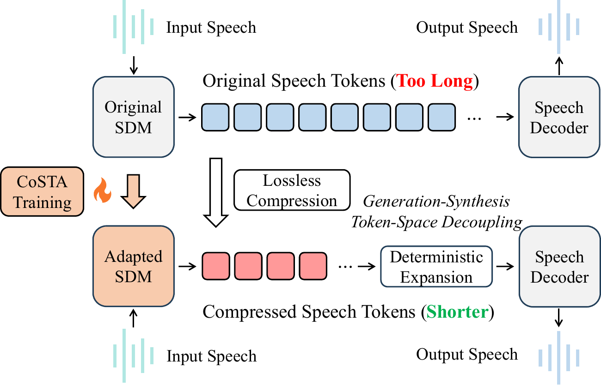
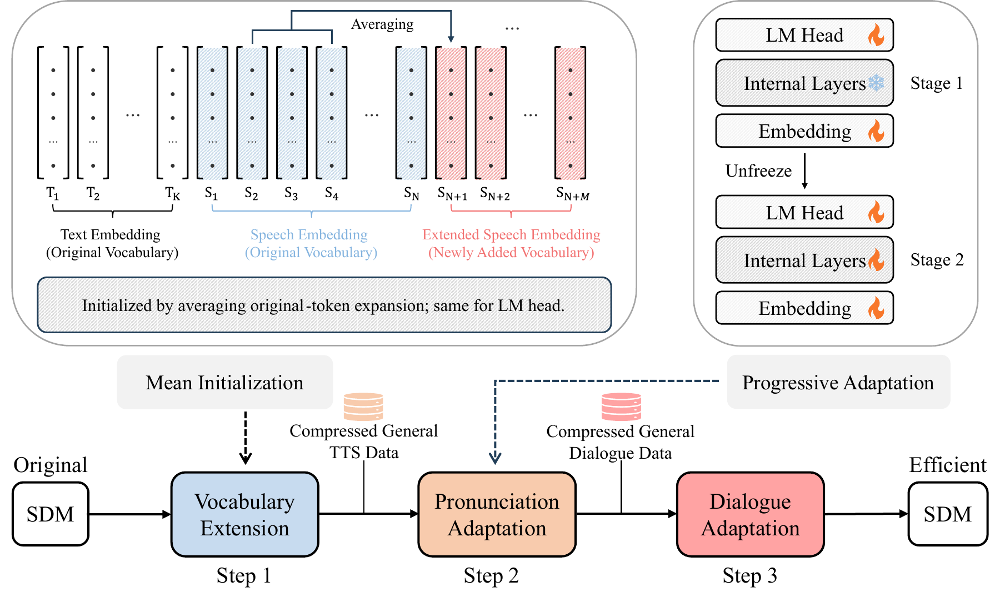

# CoSTA: Compressed Speech Token Adaptation for Efficient Spoken Dialogue Models

<div align="center">

Yingzhuo Deng<sup>1,2</sup>, Chong Li<sup>1,2</sup>, Bingxin Liu<sup>1,2</sup>, Yi Shu<sup>2</sup>, Tianyu Peng<sup>1,2</sup>,<br>
Can Xie<sup>1,2</sup>, Siyao Song<sup>1,2</sup>, Shuo Ren<sup>1</sup>, Jiajun Zhang<sup>1,2,3*</sup>

<sup>1</sup> Institute of Automation, Chinese Academy of Sciences<br>
<sup>2</sup> School of Artificial Intelligence, University of Chinese Academy of Sciences<br>
<sup>3</sup> Wuhan AI Research<br>
\* Corresponding author


[📖 Paper](https://arxiv.org/abs/2610.21143) · [💻 Code](https://github.com/yingzhuodeng/CoSTA) · **🤗 Model weights & data: Coming soon**

</div>

## 📖 Overview

**CoSTA** (**Co**mpressed **S**peech **T**oken **A**daptation) improves the inference efficiency of spoken dialogue models by decoupling the token space used for autoregressive generation from the token space required for waveform synthesis.

CoSTA learns a byte-pair encoding (BPE) vocabulary over discrete speech tokens and adapts an existing model to generate shorter, losslessly expandable speech-token sequences. The original speech tokenizer and speech decoder are retained. At inference time, compressed speech tokens are deterministically expanded before waveform synthesis.

<p align="center">
  
</p>

The adaptation procedure has three steps:

1. **Vocabulary extension:** add merged speech tokens and initialize their embedding and LM-head rows by averaging the corresponding original-token rows.
2. **Pronunciation adaptation:** train on compressed TTS targets, first updating the embedding and LM head, then unfreezing the remaining LLM layers.
3. **Dialogue adaptation:** adapt the model to speech-to-speech dialogue with compressed, interleaved text-and-speech targets.

<p align="center">
  
</p>

On the bilingual benchmarks in the paper, CoSTA improves expanded speech-token generation speed while preserving response quality:

| Model | Language | Generated-token compression rate ↓ | Expanded speech-token speed ↑ | Speed relative to Step-Audio 2 mini ↑ |
| --- | --- | --- | --- | --- |
| CoSTA-ZH | Chinese | 66.81% | 101.99 tokens/s | 173.63% |
| CoSTA-EN | English | 70.17% | 99.05 tokens/s | 165.94% |

These are the language-wise averages in Table 1 of the [paper](https://arxiv.org/abs/2610.21143). Compression rate is **compressed speech-token count / expanded speech-token count**; 66.81% means the compressed sequence retains 66.81% of the original number of tokens. Relative speed is normalized to the original model, so 173.63% corresponds to about **1.736×** speed. The paper also studies full-response latency, throughput, first-packet latency, and sustained multi-turn interaction.

## 👀 Contents

- [Release status](#-release-status)
- [Environment setup](#-environment-setup)
- [Data preparation](#-data-preparation)
- [Vocabulary training](#-vocabulary-training)
- [Model training](#-model-training)
- [Model inference](#-model-inference)
- [Citation](#-citation)
- [Acknowledgements](#-acknowledgements)

## 📦 Release Status

| Resource | Status |
| --- | --- |
| Vocabulary training, model adaptation, and inference code | Included |
| vLLM inference and benchmarking code | Coming soon |
| CoSTA-ZH / CoSTA-EN / CoSTA-MIX model weights | Coming soon |
| Trained BPE vocabularies and matching mapping files | Coming soon |
| Prepared pronunciation and dialogue adaptation data | Coming soon |
| Prepared evaluation manifests and data preparation pipeline | Coming soon |

The commands below describe the full workflow once the required inputs are available. This checkout contains source code, the paper, and upstream demonstration assets; model checkpoints and training datasets must be supplied separately. The base model, **[stepfun-ai/Step-Audio-2-mini](https://huggingface.co/stepfun-ai/Step-Audio-2-mini)**, is already public.

```text
CoSTA/
├── README.md
├── requirements.txt
├── scripts/env.sh                   # Shared paths and environment defaults
├── vocab/                          # BPE training and integer-expansion export
├── train/                          # Vocabulary extension and three adaptation stages
│   ├── step_audio2_model/          # Model definitions with training/resizing support
│   └── zero1.json                  # DeepSpeed ZeRO-1 configuration
├── inference/                      # CoSTA and original-model launchers
├── Step-Audio2/                     # Inference runtime and speech decoder implementation
├── assets/                         # Figures from the paper
└── docs/CoSTA_arxiv.pdf
```

## 🚀 Environment Setup

### 1. Install dependencies

Use Linux, Python **3.10**, and an NVIDIA CUDA environment. Our experiments use **8 × A100 80GB** for training and **1 × A100 80GB** for inference.

```bash
git clone https://github.com/yingzhuodeng/CoSTA.git
cd CoSTA

conda create -n costa python=3.10 -y
conda activate costa
pip install -r requirements.txt
```

Dependencies are pinned in `requirements.txt`, including PyTorch **2.9.1** and Transformers **4.49.0**. Use a compatible NVIDIA driver and CUDA toolkit, with FFmpeg shared libraries available for audio loading.

### 2. Configure paths

Paths are configured in [scripts/env.sh](scripts/env.sh). The defaults use `checkpoints/` for models, `data/` for prepared data, and `outputs/` for results. Adjust them as needed, then run the remaining commands from the repository root in the same shell:

```bash
source scripts/env.sh
```

The default language is Chinese (`zh`). For English or bilingual runs, start a new shell and set `COSTA_LANGUAGE=en` or `mix` before sourcing the configuration; use matching data and vocabularies.

### 3. Download the original model

```bash
hf download stepfun-ai/Step-Audio-2-mini --local-dir "$BASE_MODEL_PATH"
```

Download the complete checkpoint, including its tokenizer and `token2wav/` speech decoder. Vocabulary extension automatically uses the bundled model definitions in `train/step_audio2_model/` and saves them with the expanded checkpoint.

## 💡 Data Preparation

**Prepared data and the complete preparation pipeline will come soon.** The training scripts consume preprocessed JSONL; they do not perform voice conversion, synthesize dialogue responses, or compress targets automatically.

The paper uses **Emilia** speech converted to a consistent voice with **Seed-VC** for pronunciation adaptation, approximately **50K** dialogue examples per language following **OpenS2S**, and **CosyVoice 2** for assistant-speech synthesis. It evaluates on **URO-Bench**. Keep the original speech tokenizer fixed to **S3Tokenizer V2, 25 Hz, 6,656 speech units** for the implementation here.

The default input layout is:

```text
data/
├── vocab/zh_train_tokens.txt
├── train/
│   ├── pronunciation_stage1_zh.jsonl
│   ├── pronunciation_stage2_zh.jsonl
│   └── dialogue_zh.jsonl
├── eval/AlpacaEval-zh/test_norm.jsonl
└── audio/                          # Audio files referenced by JSONL records
```

### Vocabulary corpus

Each line of `zh_train_tokens.txt` is one original speech-token sequence, with integer IDs in **0–6655**. For example:

```text
[1822, 1614, 68, 1822, 1614, 68]
[1475, 1978, 4218, 4137]
```

These are original speech-token IDs, not LLM vocabulary IDs. Learn the vocabulary on the training split and keep it fixed for adaptation and evaluation.

### Training JSONL

Each line is an object with a `messages` list. Content can contain `text`, `audio`, and `token` items. The `token` field contains a list of **global LLM token IDs**, including the text/speech interleaving expected by Step-Audio 2 mini. The following is a structural example with illustrative IDs, not a training sample:

```json
{"messages":[{"role":"system","content":"You are a helpful assistant."},{"role":"human","content":[{"type":"text","text":"Read the following sentence: Hello."}]},{"role":"assistant","content":[{"type":"text","text":"<tts_start>"},{"type":"token","token":[151700,158352,151701]}]}]}
```

For dialogue adaptation, the human message additionally contains an audio item:

```json
{"type":"audio","audio":"data/audio/question_0001.wav"}
```

Relative audio paths are resolved from the repository root by the launchers. Absolute audio paths can also be used in your local data. Only the final assistant target is supervised by the collator; audio-patch and prompt positions are masked. The sequence limit is **16,384 tokens**.

After learning the BPE vocabulary and extending the model, prepare targets by compressing **only speech-token spans**, preserving text tokens and special markers, and mapping BPE IDs to global LLM IDs with `audio_bpeid_to_llmid.json`. Do not pass raw BPE IDs directly to the trainer. Split the pronunciation corpus into two disjoint halves for the two pronunciation stages. The paper uses **300 hours per language** before splitting.

## 🔤 Vocabulary Training

### 1. Train the speech BPE tokenizer

```bash
python vocab/train_vocab.py \
  --input "$VOCAB_TRAIN_FILE" \
  --output "$BPE_TOKENIZER_PATH" \
  --vocab-size 86656 \
  --min-frequency 2 \
  --stats-max-lines 2000
```

The total target size is **86,656 = 6,656 original units + 80,000 added units**. The script maps each original ID to a unique Unicode character, learns BPE merges, prints compression statistics, and checks a sample encode/decode round trip. A small corpus may learn fewer merges; the script prints the actual vocabulary size.

### 2. Export original-token expansions

```bash
python vocab/decode_vocab_to_ints.py \
  --tokenizer "$BPE_TOKENIZER_PATH" \
  --output "$BPE_VOCAB_PATH"
```

Each output line contains `token_id` (BPE ID), `token_str` (its Unicode representation), and `pieces` (the original speech-token sequence). Retain both generated files for model adaptation and inference.

## 🏃 Model Training

### 1. Extend the model vocabulary

```bash
python train/vocabulary_extension.py \
  --base-model "$BASE_MODEL_PATH" \
  --bpe-mapping "$BPE_VOCAB_PATH" \
  --output "$EXPANDED_MODEL_PATH"
```

This loads the base model on CPU, adds the learned merged speech tokens, initializes their embedding and LM-head rows using mean initialization, and saves a standalone expanded checkpoint. Allow sufficient host RAM for the 8B model and its resized weights. The output also includes **`audio_bpeid_to_llmid.json`**, which maps BPE IDs to LLM IDs. The implementation derives the number of new tokens from the exported vocabulary.

Once the expanded model and compressed training JSONL files are available, run the adaptation stages **in order**:

```bash
export CUDA_VISIBLE_DEVICES=0,1,2,3,4,5,6,7
export NPROC_PER_NODE=8

bash train/pronunciation_adaptation_stage1.sh
bash train/pronunciation_adaptation_stage2.sh
bash train/dialogue_adaptation.sh
```

### 2. Pronunciation adaptation — stage 1

`pronunciation_adaptation_stage1.sh` runs `train_only_vocab.py` on the first half of the pronunciation data. It updates the **entire embedding and LM-head layers**, while freezing the LLM internal layers, speech encoder, and adapter.

### 3. Pronunciation adaptation — stage 2

`pronunciation_adaptation_stage2.sh` loads the stage-1 checkpoint and runs `train.py` on the second half of the pronunciation data. The LLM internal layers are unfrozen; the speech encoder and adapter remain frozen.

### 4. Dialogue adaptation

`dialogue_adaptation.sh` loads the stage-2 checkpoint and runs `train.py` on the prepared speech-to-speech dialogue data, updating the LLM while retaining the frozen speech encoder and adapter. The external speech decoder is never part of these training stages.

| Stage | Default input checkpoint | Default data | Default output | Learning rate |
| --- | --- | --- | --- | --- |
| Pronunciation 1 | `${EXPANDED_MODEL_PATH}` | `data/train/pronunciation_stage1_zh.jsonl` | `outputs/pronunciation_stage1-zh` | `1.6e-4` |
| Pronunciation 2 | `outputs/pronunciation_stage1-zh` | `data/train/pronunciation_stage2_zh.jsonl` | `outputs/pronunciation_stage2-zh` | `2e-5` |
| Dialogue | `outputs/pronunciation_stage2-zh` | `data/train/dialogue_zh.jsonl` | `outputs/CoSTA-ZH` | `2e-5` |

All stages use **3 epochs**, BF16, AdamW, cosine scheduling, a **0.03** warmup ratio, **1.0** gradient clipping, and DeepSpeed **ZeRO-1**. The default global batch size is **8 GPUs × 1 sample/GPU × 32 accumulation steps = 256**. Changing the number of GPUs changes the effective batch size unless accumulation is adjusted.

Each stage saves its final checkpoint and BPE mapping in the output directory, with logs in `logs/train.log`. W&B runs offline. Configure stage paths in [scripts/env.sh](scripts/env.sh) and training hyperparameters in [train/run_stage.sh](train/run_stage.sh).

## 🎧 Model Inference

### 1. Prepare an evaluation manifest

Each line contains a system prompt and a human/user message with an audio item. Text can provide the task instruction or accompanying prompt; it should follow the chosen benchmark protocol. For example:

```json
{"messages":[{"role":"system","content":"You are a helpful assistant."},{"role":"human","content":[{"type":"text","text":"Please answer the spoken question."},{"type":"audio","audio":"data/audio/question_0001.wav"}]}]}
```

The batch entry points process **one user audio query per line** and prepend `<tts_start>` for the assistant. They do not replay multi-turn conversation history. Store the manifest at `data/eval/AlpacaEval-zh/test_norm.jsonl`, or set `JSONL_PATH` to another prepared file.

### 2. Run CoSTA

The final checkpoint, its matching BPE tokenizer, its ID mapping, and the original Step-Audio 2 mini decoder must all be available:

```bash
CUDA_VISIBLE_DEVICES=0 \
  bash inference/infer_costa.sh
```

The default model is `$DIALOGUE_MODEL`, the dataset is `AlpacaEval-zh`, and results are saved to `outputs/inference/AlpacaEval-zh/CoSTA-ZH`. Use the BPE tokenizer and `audio_bpeid_to_llmid.json` from the **same adaptation run**.

For custom model, data, or output paths, use the direct Python entry point:

```bash
CUDA_VISIBLE_DEVICES=0 python Step-Audio2/inf_time_s2s_bpe.py \
  --model_path "$DIALOGUE_MODEL" \
  --tokenizer_path "$DIALOGUE_MODEL" \
  --bpe_tokenizer_path "$BPE_TOKENIZER_PATH" \
  --bpe_mapping_path "$DIALOGUE_MODEL/audio_bpeid_to_llmid.json" \
  --token2wav_path "$TOKEN2WAV_PATH" \
  --prompt_wav "$PROMPT_WAV" \
  --jsonl_path "$DATA_ROOT/eval/AlpacaEval-zh/test_norm.jsonl" \
  --output_dir "$OUTPUT_ROOT/inference/AlpacaEval-zh/CoSTA-ZH" \
  --max_new_tokens 2048 \
  --repetition_penalty 1.2
```

Decoding is greedy (`do_sample=False`, `num_beams=1`). Only speech-token IDs are expanded; the text stream remains unchanged. `PROMPT_WAV` controls the reference voice used by the original decoder.

### 3. Run the original Step-Audio 2 mini baseline

```bash
CUDA_VISIBLE_DEVICES=0 \
  bash inference/infer_baseline.sh
```

This loads `$BASE_MODEL_PATH` and saves results to `outputs/inference/AlpacaEval-zh/Step-Audio-2-mini`. No trained BPE files are needed. For either launcher, set `DATASET_NAME=AlpacaEval` to use the English evaluation manifest.

### 4. Inspect outputs

| Output | Contents |
| --- | --- |
| `output_1.wav`, `output_2.wav`, … | Generated speech, synthesized at 24 kHz |
| `inference_results.jsonl` | One result or error record per processed example |
| `inference_results.json` | A formatted copy of the results |

Successful records include `generated_text`, `generated_tokens` (global LLM IDs), `final_audio_tokens` (expanded original speech IDs), `audio_tokens_bpe_len`, and `audio_tokens_decoded_len`. The legacy field **`audio_expand_ratio`** stores the **compressed/expanded percentage**, despite its name; it is `null` when no speech tokens are generated. Check for `error` records before evaluating results. Empty speech responses do not produce WAV files.

These scripts generate responses and token-count statistics. The complete timing, latency, and quality evaluation protocols reported in the paper are not implemented as a single evaluation command in this release.

## 📚 Citation

If you find CoSTA useful in your research, please cite our [paper](https://arxiv.org/abs/2610.21143):

```bibtex
@misc{deng2026costa,
  title={{CoSTA}: Compressed Speech Token Adaptation for Efficient Spoken Dialogue Models},
  author={Yingzhuo Deng and Chong Li and Bingxin Liu and Yi Shu and Tianyu Peng and Can Xie and Siyao Song and Shuo Ren and Jiajun Zhang},
  year={2026},
  eprint={2610.21143},
  archivePrefix={arXiv},
  primaryClass={cs.CL},
  url={https://arxiv.org/abs/2610.21143}
}
```

## 🙏 Acknowledgements

This implementation builds on [Step-Audio 2](https://github.com/stepfun-ai/Step-Audio2), [S3Tokenizer](https://github.com/xingchensong/S3Tokenizer), [Transformers](https://github.com/huggingface/transformers), [Tokenizers](https://github.com/huggingface/tokenizers), and [DeepSpeed](https://github.com/deepspeedai/DeepSpeed). We also acknowledge Emilia, Seed-VC, OpenS2S, CosyVoice 2, and URO-Bench for the models, data, and evaluation resources used in the paper.

Third-party code retains its original notices and licenses; see [THIRD_PARTY_NOTICES.md](THIRD_PARTY_NOTICES.md).
